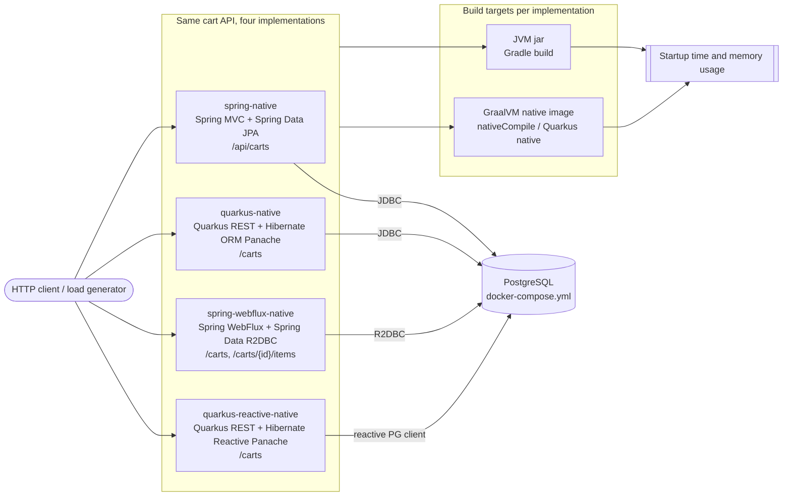

# GraalVM Spring Quarkus Benchmark

 

This repository showcases Spring and Quarkus projects implementing GraalVM native compilation, with performance comparisons against traditional JVM versions.

## Overview

The goal of this project is to evaluate the benefits and challenges of native image compilation in Java frameworks, focusing on Spring and Quarkus.

## Projects

- **[quarkus-native](./quarkus-native)**: Adds support for Quarkus Native using GraalVM, enabling the application to be compiled and run as a native binary, improving startup time and memory usage.
- **[quarkus-reactive-native](./quarkus-reactive-native)**: Implements reactive programming with Quarkus, including reactive RESTful endpoints, services, and repositories using Uni and Multi, enhancing the application's reactive capabilities.
- **[spring-native](./spring-native)**: Adds support for Spring Native with GraalVM, allowing the application to be compiled and run as a native binary, improving startup time and memory usage.
- **[spring-webflux-native](./spring-webflux-native)**: Introduces reactive programming with Spring WebFlux, including reactive endpoints using Flux and Mono, a reactive repository with R2DBC, and Flyway for database migrations, enhancing the application's reactive capabilities and ensuring smooth database migrations.

## Architecture

The same cart API (CRUD over `carts`, backed by PostgreSQL) is implemented four times, once per stack. Each implementation is built both as a JVM jar and as a GraalVM native image, and the two variants are compared on startup time and memory usage.

CI (`.github/workflows/ci.yml`) builds and tests every implementation in JVM mode; tests use in-memory H2 or mocks, so no database is required. Native images are compiled on demand by the `Native image` workflow (`.github/workflows/native.yml`).

## Metrics

We measure and compare the following metrics:

- Startup time
- Memory usage
- Throughput
- Response time

## Getting Started

### Prerequisites

- GraalVM [version]
- Maven or Gradle
- [Any other tools]

### Building and Running

[Provide basic instructions or link to detailed docs]

## Results

[Summarize key findings or link to detailed results]

## Contributing

We welcome contributions! Please see our [Contributing Guide](CONTRIBUTING.md) for details.

## License

This project is licensed under the [choose a license] - see the [LICENSE](LICENSE) file for details.

## Acknowledgments

- [Any acknowledgments or credits]
- 
